# 1. Глубокое исследование монеты Pearl (PRL) и алгоритма PearlHash / cuPOW

> **Примечание по идентификации актива:** Фонетическое название *«Purl»* соответствует криптовалюте **Pearl** (биржевой и пуловый тикер — **PRL**, официальный репозиторий — `pearl-research-labs/pearl`). В индустрии также существовал устаревший проект *Pirl* (форк Ethash/Etchash 2017–2021 гг.), однако актуальный высокодоходный GPU-майнинг на видеокартах NVIDIA RTX 40-й и 50-й серий в 2026 году относится исключительно к Layer-1 сети **Pearl (PRL)**.

---

## 1.1. Концепция сети Pearl и теоретический фундамент PoUW

**Pearl (PRL)** — это блокчейн первого уровня (Layer-1), использующий консенсус **Proof-of-Useful-Work (PoUW)** на базе алгоритма **cuPOW / PearlHash (`NoisyGEMM`)**.

В отличие от классических PoW-алгоритмов (SHA-256d, Ethash, KawPow, Blake3, Kaspa kHeavyHash), где вычислительная работа сводится к перебору криптографических хешей или чтению DAG-массива из видеопамяти, консенсус Pearl опирается на фундаментальную операцию искусственного интеллекта и инференса LLM — **матричное умножение целых чисел низкой разрядности (INT8 GEMM)**.

### Научная база и аудит протокола (2025–2026)
1. **Криптографическая основа (*Komargodski & Weinstein, 2025*, «Proofs of Useful Work from Arbitrary Matrix Multiplication»):**
   Предложена схема, в которой майнер фиксирует (через дерево Меркла на базе BLAKE3) произвольные входные матрицы $A$ и $B$, детерминированно генерирует из этого обязательства (commitment) псевдослучайный низкоранговый шум $E_A, E_B$ и вычисляет зашумлённое произведение $C' = A' \cdot B'^T$. Любая попытка схитрить или пропустить вычисление разрушается непредсказуемым шумом, а верификация на стороне блокчейна выполняется компактно через сэмплирование малого тайла и рекурсивное **Zero-Knowledge STARK-доказательство (Plonky2 / STARKy)** в модуле `zk-pow`.
2. **Эмпирическое исследование (*arXiv:2606.04819*, июнь 2026, «The Usefulness Gap in Proof-of-Useful-Work: An Empirical Study of Pearl's cuPOW Protocol»):**
   Показало фундаментальную особенность реального майнинга PRL: хотя протокол задуман для полезного инференса (`vLLM`), на практике специализированные пуловые майнеры генерируют **синтетические вырожденные сигнальные матрицы** (например, нулевую матрицу $B_{\text{sig}} = 0$ и минимально заполненную $A_{\text{sig}}$), максимизируя скорость генерации матриц, сжимаемость доказательств (до 35–80× по `gzip`) и энергоэффективность Tensor Cores.
3. **Анализ чувствительности и эволюции протокола (*Youlong Ding, arXiv:2610.25347*, октябрь 2026, «On Pearl Blockchain's Proof of Useful Work: Systematization and Flexibility»):**
   Систематизировал политику «Джекпота» (Jackpot policy), защиту от низкоранговых и константных атак, механизм штрафа за ранг (`rank penalty`) и влияние амплитуды шума на сложность.

---

## 1.2. Строгая математическая спецификация алгоритма `PearlHash` (`cert_version = 3`)

Все консенсусные правила зафиксированы в эталонном Rust-крейте `zk-pow` (`pearl-research-labs/pearl/zk-pow`). Малейшее отклонение от побитовой спецификации приводит к `100% Invalid Shares` на пуле.

### А. Допустимые размерности и ограничения (`sanity_checks.rs`)
Майнер сам выбирает геометрию матриц $(M, N, K, r)$ и паттерн хеш-тайла $(h, w)$ в рамках правил консенсуса:
* **Внешние размерности матриц:** $M \le 2^{24}$, $N \le 2^{24}$ (стандарт пулового майнинга: $M = N = 131\,072 = 2^{17}$, либо $32\,768 \dots 262\,144$).
* **Внутренняя размерность скалярного произведения ($K$):**
  * $1024 \le K \le 65\,536$ ($2^{16}$), кратно $64$;
  * $16r \le K \le 4r^2$.
  * При базовом ранге $r = 128$: допустимо $2048 \le K \le 65\,536$ (типовые профили: $K = 4096$ для плотных ядер, $K = 16\,384$ или $K = 65\,536$ для базисных ядер).
* **Ранг шума ($r$, `noise_rank`):** степень двойки $r \in \{32, 64, 128, 256, 512, 1024\}$, но после активации правила **Rank Penalty** минимально допустимый ранг:
  $$r \ge \text{PENALTY\_BASE\_RANK} = 128$$
* **Размерность хеш-тайла ($h \times w$):**
  * $32 \le h \cdot w \le 256$ (в NVIDIA-майнерах стандарт $h = 8, w = 16 \Rightarrow h \cdot w = 128$ элементов, периодический паттерн под регистровый фрагмент одного потока варпа!).
  * Ограничение размера входов воркера доказательства: $(h + w) \cdot K \le 4\text{ МиБ}$ ($2^{22}$ байт). При $h=8, w=16$ ($h+w=24$) даже максимальное $K = 65\,536$ даёт $24 \times 65\,536 = 1.5\text{ МиБ} \le 4\text{ МиБ}$!
* **Диапазон элементов сигнальных матриц (`IRANGE7P1`):**
  Все элементы исходных матриц $A_{\text{sig}} \in \mathbb{Z}^{M \times K}$ и $B_{\text{sig}}^T \in \mathbb{Z}^{N \times K}$ обязаны лежать строго в диапазоне **$[-64, +64]$** (в генераторах обычно $[-64, +63]$), чтобы после прибавления шума $[-64, +63]$ гарантированно уложиться в знаковый тип `int8_t` ($[-128, +127]$) без переполнения в цепи проверки ZK-схемы (в чистом GPU-скане используется модульная `int8` / `uint8` упаковка в пределах допустимого диапазона).
* **Dense-only softfork:** доказательства типа Mixture-of-Experts (`moe.is_some()`) отклоняются (`MoE proof rejected by the dense-only softfork`) — в сети валидны только плотные (dense) конфигурации.

---

### Б. Пошаговый криптографический конвейер попытки (Attempt Pipeline)

```mermaid
flowchart LR
    H["Заголовок блока 76 B + Config 52 B"] --> JK["job_key = BLAKE3(H || Config)"]
    JK --> MB["Merkle Root B^T (раз на задание)"]
    JK --> MA["Merkle Root A (обновление 1 чанка на Nonce)"]
    MB --> SB["b_noise_seed (Salted V3)"]
    MA --> SA["a_noise_seed (Salted V3)"]
    SB --> NB["Генерация базиса U_B и пар p_B -> B'^T"]
    SA --> NA["Генерация базиса U_A и пар p_A -> A'"]
    NA --> GEMM["Fused INT8 Tensor Core GEMM: C' = A' * B'^T"]
    NB --> GEMM
    GEMM --> FOLD["Каждые r=128 шагов K: XOR-свёртка 128 int32 -> rotl13 в Transcript[16]"]
    FOLD --> B3["Keyed BLAKE3(key=a_noise_seed, msg=Transcript[64B])"]
    B3 --> CMP{"U256_LE(digest) <= penalized_bound?"}
    CMP -- "Да (Hit!)" --> PRF["Сборка PlainProof (8 строк A + 16 строк B^T + Merkle-пути)"]
    PRF --> VER["Локальная проверка zk-pow::verify_plain_proof"]
    VER --> SUB["Отправка mining.submit (base64 / gzip v2)"]
```



#### Шаг 1. Ключ задания и обязательства (Merkle Commitments)
* Из 76-байтового заголовка блока и 52-байтовой сериализованной `MiningConfiguration` вычисляется 32-байтовый `job_key = BLAKE3(header76 || config52)`.
* Матрицы $A_{\text{sig}}$ ($M \times K$) и $B_{\text{sig}}^T$ ($N \times K$) разбиваются на листья по **1 КиБ** (1024 байта) и хешируются ключевым `BLAKE3(key = job_key)` в сбалансированное дерево Меркла (группировка по 256 листьев в `subroots`, затем редукция до корня `root_A` и `root_B`).
* **Критическая оптимизация Zero-B + Incremental Nonce:**
  * $B_{\text{sig}}^T \equiv 0$: корень `root_B` и все поддеревья нулевой матрицы зависят только от `job_key` и вычисляются **1 раз на задание пула** (раз в ~15–30 секунд) без чтения нулей из памяти!
  * В матрице $A_{\text{sig}}$ при переборе `nonce` изменяются только первые байты чанка №0 (или фиксированной строки). Пересчёт `root_A` требует **1 вызова BLAKE3 для чанка №0 и ~19 родительских хешей вдоль одной ветви дерева Меркла** (менее `5 микросекунд` на CPU!).

#### Шаг 2. Генерация солёных сидов шума (`cert_version = 3`, Salted Seed Hard Fork)
Для защиты от предвычисления и подбора матриц хардфорк V3 ввёл привязку корней с солями `SEED_SALT_A` / `SEED_SALT_B` (`SeedDerivation::Salted`). Майнер обязан читать поле `cert_version` из `mining.notify` (по умолчанию `3`). Со старой деривацией V1/V2 пул отклонит 100% шар.

#### Шаг 3. Структура низкорангового шума (`noise_generation`)
Для каждой стороны ($X \in \{A, B^T\}$ с сидом `seed_X` и числом строк $R_{\text{rows}} \in \{M, N\}$):
1. **Равномерная матрица базиса $U_X \in \text{int8}^{R_{\text{rows}} \times r}$:**
   Генерируется вызовами одноблочного ключевого BLAKE3 от `(1 + idx, zeros, "A_tensor" / "B_tensor")` под ключом `seed_X`. При $r = 128$ на каждую строку нужно ровно $128$ байт = **4 хеша BLAKE3 по 32 байта**. Каждый байт $b$ переводится в знаковый диапазон шума битовой маской и сдвигом (например, `(b & 63) - 32` или `(b & range_mask) - zero_point`).
2. **Разреженная матрица перестановок пар $P_X \in \{-1, 0, +1\}^{r \times K}$:**
   Для каждого столбца $k \in [0, K)$ из BLAKE3-хеша извлекается `uint32_t u` и вычисляются ровно **два различных индекса** в $[0, r)$:
   ```cpp
   uint32_t p0 = u & (r - 1);
   uint32_t p1 = p0 ^ (1u + (uint32_t)(((uint64_t)(r - 1) * u) >> 32));
   ```
   Тогда зашумлённый элемент матрицы равен:
   $$X'[i, k] = X_{\text{sig}}[i, k] + U_X[i, p_0[k]] - U_X[i, p_1[k]]$$
   **Ключевое следствие для архитектуры майнера:** при $X_{\text{sig}}[i, k] = 0$ вся строка длины $K = 16\,384 \dots 65\,536$ полностью определяется всего лишь **128 байтами базиса $U_X[i, \cdot]$** и глобальной таблицей пар $(p_0[k], p_1[k])$ размером $4K$ байт!

#### Шаг 4. Накопление GEMM, XOR-свёртка и Транскрипт (`Transcript`)
Для каждого хеш-тайла $(t_{\text{rows}}, t_{\text{cols}})$ размером $h \times w = 128$ выходных элементов поддерживается:
* Массив текущих 32-битных сумм `acc[128]` (`int32_t`), обнуляемый перед началом $K$-цикла;
* 64-байтовый буфер транскрипта `T[0..15]` (`16 × uint32_t`), инициализированный нулями.

Цикл по внутренней размерности $K$ идёт шагами по $r = 128$ (`step = 0 .. (K/128) - 1`):
1. Накапливается частичное матричное произведение:
   $$\text{acc}[u, v] \mathrel{+}= \sum_{k = 128\cdot\text{step}}^{128\cdot(\text{step}+1)-1} \text{int32}(A'[r_u, k]) \cdot \text{int32}(B'^T[c_v, k])$$
2. Все $h \cdot w = 128$ кумулятивных аккумуляторов `acc` сворачиваются побитовым `XOR` в одно 32-битное слово `fold_word`:
   $$\text{fold\_word} = \bigoplus_{(u,v) \in \text{Tile}} \text{uint32}(\text{acc}[u, v])$$
3. Слово `fold_word` вливается в циклический слот транскрипта с циклическим сдвигом влево на **13 бит** (`HASH_ACCUMULATE_ROTATION = 13`):
   $$\text{idx} = \text{step} \bmod 16, \qquad T[\text{idx}] \leftarrow \text{rotl32}(T[\text{idx}], 13) \oplus \text{fold\_word}$$
   *(Замечание: при $\text{step} < 16$ начальное значение $T[\text{idx}] = 0$, поэтому $\text{rotl32}(0, 13) \oplus \text{fold\_word} = \text{fold\_word}$).*

#### Шаг 5. Финальный Jackpot Hash и штраф за ранг (`Rank Penalty`)
После завершения всех $K/128$ шагов 64-байтовый транскрипт $T[0..15]$ (в little-endian представлении) сжимается **одним вызовом одноблочного ключевого BLAKE3** с ключом `pow_key = a_noise_seed`:
$$\text{hash\_jackpot} = \text{BLAKE3\_keyed}(\text{key} = \text{a\_noise\_seed}, \text{msg} = T_{64\text{B}})$$
Полученный 256-битный хеш интерпретируется как `U256` (little-endian) и сравнивается с масштабированным порогом сложности (`penalized_target_bound`):
$$\text{adjustment\_factor} = (h \cdot w) \cdot \left\lfloor \frac{K}{r} \right\rfloor \cdot 128$$
$$\text{U256\_LE}(\text{hash\_jackpot}) \le \text{target}_{\text{share}} \times \text{adjustment\_factor}$$
* **Почему $r = 128$ строго оптимален:** при $r = 128$ множитель равен $(h \cdot w) \cdot K$ — каждая выполненная MAC-операция линейно увеличивает вероятность нахождения шары! Если увеличить ранг до $r = 256$, порог уменьшается вдвое (штраф $2\times$!); если уменьшить $r < 128$ — шара отвергается консенсусом (`Rank must be >= 128`).

---

## 1.3. Формула расчёта хешрейта и соответствие железу

В экосистеме Pearl (пулы Kryptex, HeroMiners, LuckyPool, 2Miners, калькуляторы WhatToMine / Hashrate.no) принята единая метрика:
$$\mathbf{1\text{ H/s (Pearl)} = 1\text{ INT8 MAC/s} = 2\text{ INT8 TOPS-операций/с}}$$
Для одного хеш-тайла $8 \times 16$ при длине скалярного произведения $K$:
$$\text{MACs}_{\text{tile}} = 8 \times 16 \times K = 128 \cdot K$$
За один полный проход матриц $M \times N$ число тайлов равно $\frac{M \cdot N}{128}$, а суммарная полезная работа равна ровно:
$$\text{MACs}_{\text{pass}} = \frac{M \cdot N}{128} \cdot (128 \cdot K) = M \cdot N \cdot K$$
Например, при $M = N = 131\,072, K = 4096$: один проход содержит **$7.03687 \times 10^{13}$ MAC ($70.37\text{ TMAC}$)** и длится на RTX 5090 всего **~0.165 секунды**!

---

## 1.4. Сетевые протоколы пулов (Stratum Dialects) и сжатие доказательств

В отличие от классических PoW-монет, где `mining.submit` передаёт 8-байтовый `nonce`, в Pearl майнер отправляет пулу сериализованную структуру **`PlainProof`** (`bincode`), содержащую:
* Публичные параметры и индексы выигравшего тайла $(t_{\text{rows}}, t_{\text{cols}})$;
* Вскрытые $h = 8$ строк матрицы $A_{\text{sig}}$ длины $K$ ($8K$ байт);
* Вскрытые $w = 16$ столбцов (строк $B_{\text{sig}}^T$) длины $K$ ($16K$ байт);
* Многолистовые Merkle-пути (`pearl_blake3::get_multileaf_proof`) к корням `root_A` и `root_B`.

*(Генерацию тяжёлого ZK-STARK доказательства Plonky2 для блокчейна выполняет сам пул/шлюз `pearl-gateway` только тогда, когда сложность шары достигла сложности полного блока сети!)*

### Два основных диалекта Stratum в сети Pearl:
1. **Object Stratum (HeroMiners, LuckyPool, 2Miners, BaikalMine):**
   JSON-RPC по TCP/TLS с именованными полями объекта параметров, кодирование `plain_proof` в `base64` (либо опционально `zstd`). При большом $K$ (например, $K = 65\,536$) несжатый `PlainProof` весит более `1.5 МБ` в base64 и может превысить лимит фрейма пула, поэтому для пулов без сжатия используется $K = 4096$ (~68 КБ base64).
2. **Kryptex Gzip Stratum v2 (`prl.kryptex.network:7048` / `8048` TLS):**
   В `mining.authorize` передаётся `"type": "v2"`. Если пул подтверждает `"type": "v2"`, поле `plain_proof` передаётся как **`base64(gzip(bincode(PlainProof)))`**. Поскольку $B_{\text{sig}}^T \equiv 0$, а $A_{\text{sig}}$ заполнена нулями или повторяющимся паттерном кроме nonce-слова, размер шары сжимается **в 35–80 раз** (например, с `68 160` символов до `1 948` символов при $K=4096$, и легко пролетает за миллисекунды даже при $K = 65\,536$!).

---

## 1.5. Грядущий хардфорк `cert_version = 4` (FP8 Tensor Cores)

Анализ исходных кодов репозиториев `pearl-research-labs/pearl` и `spark-pearl-miner` показывает подготовку протокола к переходу на **сертификаты версии 4 (`cert_version = 4`)**, использующие вещественный формат низкой разрядности **FP8 (`E4M3` с накоплением в `FP32` в строго возрастающем порядке по $K$ без split-K)**.

**Стратегическое преимущество для нашего целевого железа:**
* Видеокарты RTX 30-й серии (`sm_86` Ampere) **не имеют аппаратных FP8 Tensor Cores**!
* Видеокарты **RTX 40-й серии (`sm_89` Ada Lovelace)** и **RTX 50-й серии (`sm_120` Blackwell)** поддерживают нативную инструкцию `mma.sync.aligned.m16n8k32...f32.e4m3.e4m3.f32` (`QMMA.16832`) **с точно таким же темпом исполнения (1024 MAC/clk/SM) и точно такой же раскладкой регистровых фрагментов**, что и `INT8`! Закладка шаблонизированного ядра `MmaPolicy<Int8V3 | Fp8V4>` на этапе архитектуры обеспечит мгновенное доминирование нашего майнера в день активации V4.
