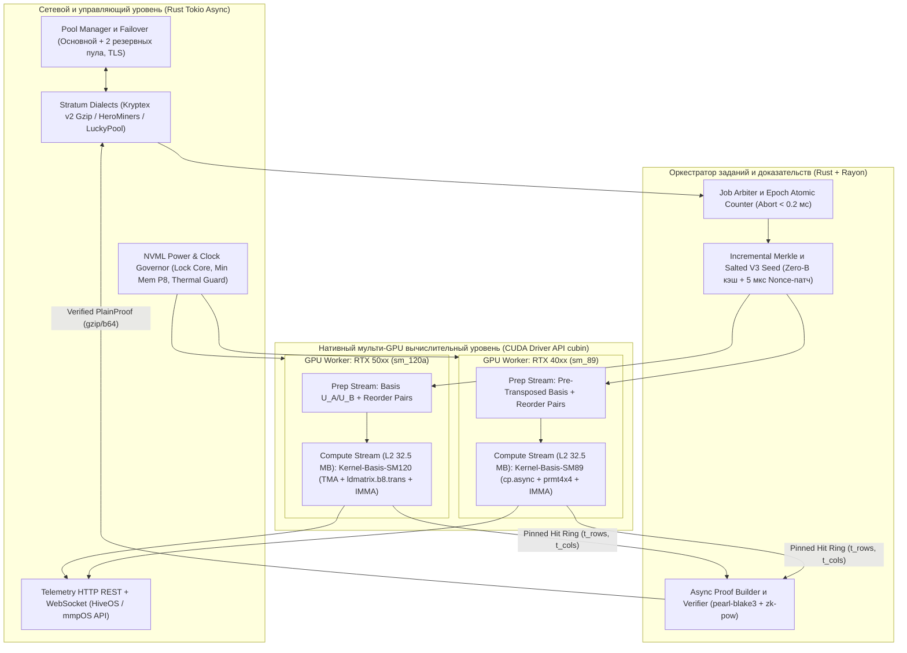

# 4. Концепция и детальная архитектура собственного высокоэффективного майнера (`ApexPRL`)

На основе проведённого аудита протокола Pearl, исходных кодов лучших открытых реализаций и микроархитектуры NVIDIA Ada (`sm_89`) / Blackwell (`sm_120`) разработана архитектура собственного промышленного майнера **ApexPRL** с **0% Dev Fee**, нацеленного на максимальный чистый хешрейт на Ватт (`TH/s per Watt`) и нулевой процент бракованных/опоздавших шар.

---

## 4.1. Ключевые архитектурные принципы `ApexPRL`

1. **Zero Dev Fee & Zero Context-Switch:** 100% времени GPU работает исключительно на кошелёк владельца без переключений пулов, сбросов кэша базиса B и накладных расходов `tile-debt`.
2. **Гибридный двухъядерный вычислительный движок (`Basis L2-Resident Engine` + `Dense TMA/Copy-Warp Engine`):**
   * По умолчанию на пулах с поддержкой сжатия (`Kryptex v2 gzip`, `zstd`) активируется **L2-резидентный базисный движок (`K = 16384` или `K = 65536`)**, удерживающий весь рабочий набор (`32.5 МиБ`) внутри L2-кэша видеокарты и снижающий энергопотребление подсистемы памяти на **35–75 Вт**.
   * Для пулов без сжатия доказательств автоматически включается оптимизированный плотный движок (`K = 4096`) с удержанием полос в L2.
3. **Раздельные нативные тракты PTX/SASS для `sm_120a` (RTX 50) и `sm_89` (RTX 40):** никакой универсальной компиляции «под `sm_80`» — каждая архитектура получает собственный скомпилированный бинарный модуль (`cubin`), использующий аппаратный TMA и `ldmatrix.m16n16.x2.trans.b8` на RTX 50 и пред-транспонированный `cp.async + prmt.b32` конвейер на RTX 40.
4. **Эталонный консенсусный слой без велосипедов:** прямое статическое связывание официальных Rust-крейтов `pearl-blake3` и `zk-pow` (лицензия ISC) для инкрементального расчёта Merkle-корней, сборки `PlainProof` и обязательной локальной пред-проверки 100% шар перед отправкой на пул.
5. **Готовность первого дня к хардфорку `cert_version = 4` (FP8):** шаблонизация главного цикла ядра под `IMMA.16832` (INT8, V3) и `QMMA.16832` (FP8 `e4m3 -> f32`, V4).
6. **Нативный мульти-GPU в одном процессе (1..16 карт на риг):** независимый асинхронный контекст CUDA Driver API + собственные `CUDA Streams` и закреплённые потоки CPU (`Thread Affinity`) на каждую видеокарту, допускающие смешанные риги (например, `RTX 5090 + RTX 4090 + RTX 5080` в одной тушке!).

---

## 4.2. Высокоуровневая модульная архитектура системы



---

## 4.3. Выбор технологического стека

| Подсистема | Технология | Обоснование выбора |
| :--- | :--- | :--- |
| **Хост-приложение, сеть, пулы, конфигурация, UI** | **Rust (Edition 2024, `tokio`, `rustls`, `flate2`/`miniz_oxide`, `serde`)** | Безопасная многопоточность для ригов на 8–12 карт, прямая нативная компиляция с официальными крейтами сети Pearl (`zk-pow`, `pearl-blake3` написаны на Rust!), отсутствие внешних зависимостей и утечек памяти |
| **Загрузка GPU и управление памятью** | **CUDA Driver API (`libcuda.so` / `nvcuda.dll` через динамическую загрузку)** | Не требует установки CUDA Toolkit на фермах пользователей (достаточно обычного драйвера NVIDIA 550+ для RTX 40 и 570+/620+ для RTX 50); тонкий контроль `cuMemSetAccess` и `CUaccessPolicyWindow` (L2 Persistence!) |
| **Вычислительные ядра GPU** | **CUDA C++20 + Inline PTX (`nvcc` 12.8 / 13.4 -> встроенные `cubin`-блобы)** | Полный контроль над инструкциями `IMMA.16832`, `QMMA.16832`, `ldmatrix`, `cp.async.bulk`, `lop3.b32`, `shf.l.wrap.b32` и флагами `ptxas -O1` отдельно для каждого `sm_89` и `sm_120a` |
| **Управление железом и мониторинг** | **NVML (`nvml.dll` / `libnvidia-ml.so`)** | Чтение реальных частот SM, энергопотребления с точностью 10 Гц, температур ядра/памяти, программный лок частот ядра и **принудительный сброс частоты видеопамяти в нижний P-state** для экономии десятков ватт |
| **Сборка и дистрибуция** | **Единый статический бинарник** (`apexprl.exe` / `apexprl`) + архив HiveOS Custom Miner | Никаких внешних `.dll`/`.so`, распаковок во временные папки `%TEMP%` (на что ругается антивирус) или Python-скриптов |

---

## 4.4. Детальное устройство вычислительного конвейера на GPU (Per-Device Engine)

Каждая видеокарта в риге обслуживается выделенным экземпляром `GpuDeviceEngine` с жёстким лимитом видеопамяти **`< 512 МиБ VRAM`** в базисном режиме (и `< 1.6 ГиБ VRAM` в плотном режиме), что позволяет запускать майнер даже параллельно с рабочими задачами или LLM-сервером!

### А. Разметка памяти и удержание в L2 кэше (`L2 Cache Persistence`)
При инициализации устройства в базисном режиме выделяются буферы:
1. `d_basA` (`16 МиБ` при $M=131\,072, r=128$) — упакованный базис шума $U_A$;
2. `d_basB` (`16 МиБ` при $N=131\,072, r=128$) — упакованный базис шума $U_B$ (обновляется только 1 раз на новое задание пула!);
3. `d_pairs` (`512 КиБ` при $K \le 65\,536$) — переставленные пары индексов $(p_{0,A}, p_{1,A}, p_{0,B}, p_{1,B})$;
4. `d_corr` (`64 КиБ`) — предвычисленные поправки для граничного фрагмента с `nonce`;
5. `h_pinned_ctrl` (Mapped Pinned Memory, `4 КиБ`) — атомарный флаг отмены `abort_epoch` (для мгновенной остановки ядра при `mining.notify`) и кольцевой буфер найденных шар `HitRing` (`count`, `tile_ids[]`).

Через `cudaCtxSetLimit(cudaLimitPersistingL2CacheSize, 34 * 1024 * 1024)` и `cudaStreamSetAttribute(..., cudaLaunchAttributeAccessPolicyWindow)` буферы `d_basA` и `d_basB` (`32 МиБ`) **прибиваются к аппаратному L2 кэшу** чипа (`hitRatio = 1.0`, `CU_ACCESS_PROPERTY_PERSISTING`).

---

### Б. Четыре стадии одной попытки (`Nonce Attempt`)

| Стадия | Где выполняется | Длительность (RTX 5090 / 4090) | Описание операции |
| :--- | :---: | :---: | :--- |
| **1. Nonce Merkle Update** | Host CPU (1 поток) | **~0.005 мс** (5 мкс!) | Запись нового 64-битного `nonce` в чанк №0 матрицы $A_{\text{sig}}$, пересчёт 1 листа и 19 узлов ветви дерева Меркла $\to$ `root_A` $\to$ солёный V3 `a_noise_seed` |
| **2. Basis & Pair Prep** | GPU `prep_stream` | **~0.18 – 0.30 мс** | Генерация `16 МиБ` равномерного базиса `d_basA` (одноблочный регистровый BLAKE3 в 256-поточных блоках) + `build_pairs` + жадная перестановка столбцов `reorder_pairs` внутри каждого 128-$K$ блока (снижение конфликтов банков Shared Memory на ~45–50%) |
| **3. Persistent Basis GEMM + Jackpot** | GPU `compute_stream` | **~160 мс** ($K=4096$) / **~640 мс** ($K=16384$) | Запуск ровно $N_{\text{SM}}$ персистентных блоков (`170 CTA` на RTX 5090, `128 CTA` на RTX 4090). Внутри каждого тайла $160 \times 256$: загрузка 52 КиБ базиса из L2 $\to$ потоковая сборка операндов в SMEM $\to$ `IMMA.16832` (`u8.u8.s32`) $\to$ потоковый XOR-фолд (`lop3.b32` + `shf.l.wrap.b32` rotl-13) $\to$ финальный регистровый `BLAKE3_keyed` $\to$ запись попаданий в `HitRing` |
| **4. Async Witness & Submit** | Host Rayon Pool (фоново!) | **~0.8 мс** *(не тормозит GPU!)* | Пока GPU уже считает следующий `nonce`! Поток пула восстанавливает 8 строк $A_{\text{sig}}$ и 16 нулевых строк $B_{\text{sig}}^T$, собирает Merkle-пути, проверяет шару через `zk-pow::verify_plain_proof`, сжимает в `gzip` и отправляет `mining.submit` |

> **Обратите внимание на накладные расходы подготовки:** `0.25 мс` подготовки на `640 мс` чистого счёта при $K = 16\,384$ — это **менее `0.04%` потерь времени между попытками** (`99.96%` времени Tensor Cores заняты полезным матричным умножением)!

---

### В. Микроархитектура вычислительных ядер по поколениям карт

#### 1. Специализированное ядро `Kernel-Basis-SM120` (для RTX 5070 / 5070 Ti / 5080 / 5090)
* **Геометрия CTA:** `BM = 160, BN = 256` (`8 варпов`, варп-тайл `WM = 80, WN = 64` $\Rightarrow$ `5 × 8 = 40` аккумуляторов `m16n8` = `160 int32` регистров на поток).
  *(Плюс дополнительный профиль `BM = 192, BN = 256` / `BM = 128, BN = 256` в автотюнере для младших карт `GB205`).*
* **Порядок обхода тайлов (`L2 Swizzled Strip Raster`):** змейкой полосами шириной `G = 8` или `16` тайлов по $N$, чтобы все 170 SM одновременно переиспользовали одни и те же строки `d_basA` и столбцы `d_basB` из L2 кэша.
* **Проверка флага отмены (`Zero-Overhead Preemption`):** перед стартом каждого нового тайла $160 \times 256$ поток `tid == 0` читает `ld.global.acquire.gpu.u32` слово `abort_epoch`. Поскольку один тайл при $K = 16\,384$ занимает на RTX 5090 всего **`~0.25 миллисекунды`**, при получении нового блока от пула все 170 SM мягко завершают работу за **`0.25 мс`** без сброса драйвера!
* **Доставка базиса:** `cp.async.bulk.shared::cta.global.mbarrier::complete_tx::bytes` (`52 КиБ`) + `mbarrier.try_wait.parity`.
* **Внутренний шаг $K=32$:**
  * Загрузка пар индексов `ld.global.nc.v2.u32`;
  * Сборка следующего этапа через `ldmatrix.sync.aligned.m16n16.x2.trans.shared.b8` и сдвиг знака `+ 0x40404040u - ...`;
  * Непрерывная серия из 40 инструкций `mma.sync.aligned.m16n8k32.row.col.s32.u8.u8.s32` с оптимально расставленными точками `P0..P7, PL` при `-Xptxas -O1`;
  * Потоковая XOR-свёртка (`lop3.b32` с таблицей истинности `0x96`), размазанная по итерациям следующей группы из 4 шагов, чтобы избежать пиковой нагрузки на целочисленный пайп в конце 128-$K$ чанка!

#### 2. Специализированное ядро `Kernel-Basis-SM89` (для RTX 4070 / 4070 Ti / 4080 / 4090)
* **Геометрия CTA:** `BM = 160, BN = 256` (и альтернативный профиль `BM = 128, BN = 256` на `128 рег. acc` для запаса регистров под `prmt.b32`).
* **Пред-транспонированная упаковка базиса в `prep_stream`:** ядро генерации базиса на `sm_89` сразу укладывает каждую компоненту $c \in [0, 128)$ полосы из 16 строк в виде непрерывного 16-байтового вектора `uint4` со сдвигом банков `(c ^ (row_group & 7))` для бесконфликтного чтения `ld.shared.v4.u32`.
* **Доставка базиса в начале тайла:** кооперативный `cp.async.cg.shared.global` (16 байт на поток × 13 проходов, `cp.async.commit_group` + `cp.async.wait_group 0`).
* **Сборка фрагментов в тени Tensor Cores:** чтение `ld.shared.v4.u32` компонент $p_0, p_1$, векторное вычитание со смещением `+0x40` и регистровое транспонирование $4 \times 4$ байтовых матриц через пару инструкций `prmt.b32` на свободном целочисленном конвейере параллельно с исполнением `IMMA.16832`!

#### 3. Шаблон расширения `Kernel-V4-FP8` (`cert_version = 4`)
* Определяется compile-time политика `MmaTrait`:
  * `V3_Int8`: `mma.sync.aligned.m16n8k32.row.col.s32.u8.u8.s32` (`acc` в `int32_t`);
  * `V4_Fp8`: `mma.sync.aligned.m16n8k32.row.col.f32.e4m3.e4m3.f32` на `sm_89` и `.kind::f8f6f4.f32.e4m3.e4m3.f32` на `sm_120a` (`acc` в `float`, строго последовательное накопление по $K$ без split-K для 100% детерминизма IEEE-754!).
* Поскольку отображение `(lane, reg_idx) -> (row, col)` у `m16n8k32` для `INT8` и `FP8` на архитектурах NVIDIA **абсолютно идентично**, вся инфраструктура тайлинга, периодических хеш-тайлов $8 \times 16$, транскриптов в Shared Memory и BLAKE3-эпилога переиспользуется на 100%!

---

## 4.5. Подсистема энергоэффективности и авто-тюнинга (`ApexTune & NVML Governor`)

В реальном майнинге главная статья расходов — электроэнергия. `ApexPRL` включает встроенный аппаратный оптимизатор (работающий с правами администратора на Windows и `root` на Linux/HiveOS без стороннего MSI Afterburner):

1. **Автоматическая блокировка видеопамяти в нижнем энергосостоянии (`--lock-mem-idle`, для Basis Kernel):**
   Поскольку базисное ядро работает внутри L2 кэша и почти не обращается к чипам GDDR6X / GDDR7, принудительная фиксация частоты памяти через `nvmlDeviceSetMemoryLockedClocks(dev, 810, 810)` (или `5001 МГц` P5 в зависимости от BIOS карты) **мгновенно снижает потребление контроллера памяти и чипов VRAM на 25–65 Вт** и роняет температуру памяти (`VRAM Junction Temp` на GDDR6X/GDDR7) с `80–92 °C` до **`48–56 °C`**, продлевая ресурс дорогих карт RTX 4090 / 5090!
2. **Точный лок частоты ядра по кривой КПД (`--cclock-lock MHz` / `--efficiency-target`):**
   Фиксация частоты SM через `nvmlDeviceSetGpuLockedClocks` позволяет вывести чип в «золотую точку» вольт-частотной кривой:
   * **RTX 5090:** лок ядра `2150–2300 МГц` + память `min` $\to$ **~390–410 TH/s всего при ~340–380 Вт** (> `1.10 TH/s на Ватт` против `0.74 TH/s/W` в стоке!), либо `2550 МГц` для максимального хешрейта **~438 TH/s при ~485 Вт**!
   * **RTX 4090:** лок ядра `2250–2400 МГц` + память `min` $\to$ **~305–325 TH/s всего при ~230–265 Вт** (> `1.25 TH/s на Ватт`!), либо `2700 МГц` для **~348 TH/s при ~335 Вт**!
3. **Персональный микробенчмарк вариантов ядра (`--tune`):**
   При первом старте майнер за 35–40 секунд в случайном чередовании (interleaved A/B, чтобы исключить влияние нагрева карты!) замеряет скомпилированные в бинарник варианты расстановки инструкций `P0..P7` и размеров тайла (`160×256` vs `128×256` vs `192×256`), верифицирует каждый вариант на эталонном векторе и сохраняет лучший профиль в `apexprl_tune.json` с привязкой к `(GPU UUID, Driver Version, Power Limit)`.
4. **Сторожевой таймер целостности вычислений (`Canary Self-Check`):**
   При агрессивном андервольте или переразгоне ядра карта может начать выдавать редкие битовые ошибки в Tensor Cores без падения драйвера. Раз в попытку (стоимость `< 0.05 мс` на CPU) хост пересчитывает 1 случайный «канареечный» тайл на CPU и проверяет каждую найденную шару через `zk-pow`. При расхождении майнер логирует предупреждение по конкретному `GPU ID` и может автоматически снизить частоту ядра на `-30 МГц`, спасая риг от реджектов и бана на пуле!

---

## 4.6. Проектируемая структура репозитория разработки

Ниже представлена целевая файловая архитектура проекта внутри рабочей директории `D:\dev\Разработка майнера`:

```text
Разработка майнера/
├── README.md                                     # Навигация по проекту и резюме
├── ОТЧЕТ_ИССЛЕДОВАНИЕ_И_АРХИТЕКТУРА_МАЙНЕРА_PEARL.md  # Главный сводный отчёт НИОКР
├── docs/
│   ├── 01_Исследование_экосистемы_и_алгоритма_Pearl.md
│   ├── 02_Анализ_существующих_майнеров.md
│   ├── 03_Микроархитектура_RTX40_Ada_и_RTX50_Blackwell.md
│   └── 04_Концепция_и_архитектура_собственного_майнера.md
├── Cargo.toml                                    # Workspace Rust (при старте фазы кодирования)
├── crates/
│   ├── apexprl-cli/                              # Точка входа, CLI, конфигурация TOML, сигналы ОС
│   ├── apexprl-pow/                              # Обёртка над эталонными pearl-blake3 и zk-pow (V3 + V4 stub)
│   ├── apexprl-stratum/                          # Async TCP/TLS Stratum (Kryptex v2 gzip, HeroMiners, LuckyPool, Failover)
│   ├── apexprl-gpu/                              # FFI к CUDA Driver API, L2 Persistence, HitRing, автотюнер
│   ├── apexprl-nvml/                             # Управление частотами ядра/памяти, лимитами и телеметрией
│   └── apexprl-api/                              # HTTP JSON API (HiveOS/mmpOS) + встроенный Web UI
├── kernels/                                      # Нативные вычислительные ядра CUDA C++ / PTX
│   ├── common/
│   │   ├── blake3_reg.cuh                        # Одноблочный ключевой BLAKE3 в регистрах
│   │   ├── basis_prep.cu                         # Генерация U_A/U_B и жадный reorder_pairs (-45% bank conflicts)
│   │   └── pow_fold.cuh                          # Инлайновые lop3.b32 XOR и shf.l.wrap.b32 rotl-13
│   ├── sm120_blackwell/
│   │   ├── kernel_basis_sm120.cu                 # Основное ядро RTX 50: TMA + ldmatrix.b8.trans + IMMA.16832 (ptxas -O1)
│   │   ├── kernel_dense_sm120.cu                 # Fallback ядро RTX 50: TMA 2D + setmaxnreg (K=4096)
│   │   └── variants_sm120.toml                   # Таблица комбинаций P0..P7 для автотюнера Blackwell
│   └── sm89_ada/
│       ├── kernel_basis_sm89.cu                  # Основное ядро RTX 40: cp.async + prmt4x4 + IMMA.16832 (ptxas -O1)
│       ├── kernel_dense_sm89.cu                  # Fallback ядро RTX 40: 9-warp copy-warp + wave sync
│       └── variants_sm89.toml                    # Таблица комбинаций для автотюнера Ada Lovelace
├── third_party/                                  # Вендоринг ISC-крейтов pearl-blake3 и zk-pow
├── tools/
│   ├── check_sass.py                             # Аудит cuobjdump SASS (0 STL/LDL spills, наличие IMMA.16832)
│   ├── tune_sweep.py                             # Автоматический поиск оптимальных P0..P7 через Nsight / тайминг
│   └── package_hiveos.sh                         # Сборка пакета Custom Miner для HiveOS
└── scripts/
    ├── build_windows.ps1                         # Сборка единого apexprl.exe (MSVC + CUDA 12.8/13.x + Rust)
    └── build_linux.sh                            # Сборка под Ubuntu / HiveOS
```

---

## 4.7. Дорожная карта реализации (4 инженерных этапа)

| Фаза | Задачи этапа | Критерий приёмки (Definition of Done) |
| :--- | :--- | :--- |
| **Этап 1. Эталонное ядро консенсуса и верификатор (`apexprl-pow` + G0 Gate)** | Подключение крейтов `pearl-blake3` и `zk-pow` (`cert_version = 3`), реализация `Zero-B` дерева Меркла, инкрементального патча `nonce` за `< 10 мкс`, CPU-эталона транскриптов и упаковки `PlainProof` (`base64` + `gzip`). | 100% прохождение эталонных тест-векторов `zk-pow::verify_plain_proof` оффлайн на размерах $M, N \in \{256..131072\}, K \in \{4096, 16384, 65536\}$. |
| **Этап 2. Вычислительные ядра GPU (`sm_120a` Blackwell и `sm_89` Ada)** | Разработка `basis_prep.cu` (`reorder_pairs`), `kernel_basis_sm120.cu` (RTX 50) и `kernel_basis_sm89.cu` (RTX 40) + `kernel_dense` fallback. Настройка сборки `cubin` с `-Xptxas -O1` и SASS-проверки (`0 spills`). | Побитовое совпадение всех `m·n/128` транскриптов GPU с CPU-эталоном (Gate G0); достижение **$\ge 96\%$ от аппаратного пика `IMMA.16832`** при фиксированной частоте ядра и **100% L2 Hit Rate** в Nsight Compute. |
| **Этап 3. Мульти-GPU ран-тайм и сетевой стек Stratum v2** | Динамический загрузчик `nvcuda.dll`/`libcuda.so`, поддержка смешанных ригов RTX 40 + RTX 50 в одном процессе, `HitRing` с временем прерывания `< 0.3 мс`, клиент Stratum (`Kryptex v2 gzip`, `HeroMiners`, `LuckyPool`, TLS, Pure-Reducer Failover). | Непрерывный 24-часовой soak-тест на живых пулах: `Invalid Shares = 0.00%`, `Stale Shares < 0.3%`, 0% Dev Fee, стабильная работа при обрывах связи. |
| **Этап 4. Автотюнер `ApexTune`, NVML Governor и релиз под Windows / HiveOS** | Интеграция NVML (лок минимальной частоты памяти GDDR6X/GDDR7 и оптимальной частоты ядра, защита по температуре), 40-секундный стартовый `--tune` профилей ядра, HTTP API совместимости с HiveOS/mmpOS, Web-дашборд и задел `MmaTrait::Fp8V4`. | Снижение энергопотребления рига на **12–20% при сохранении/росте хешрейта**, готовый пакет `apexprl-hiveos.tar.gz` и одиночный `apexprl.exe` для Windows. |
